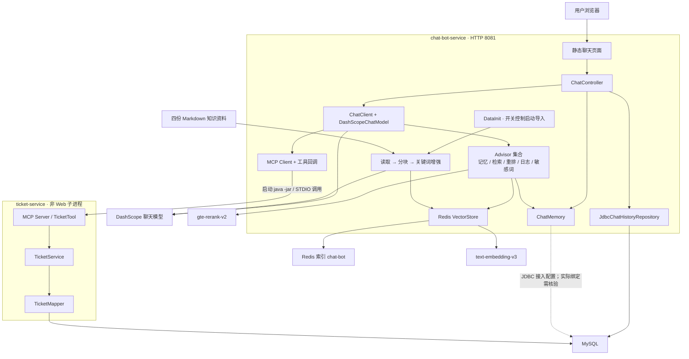
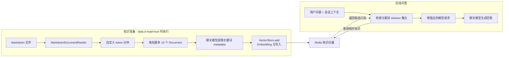
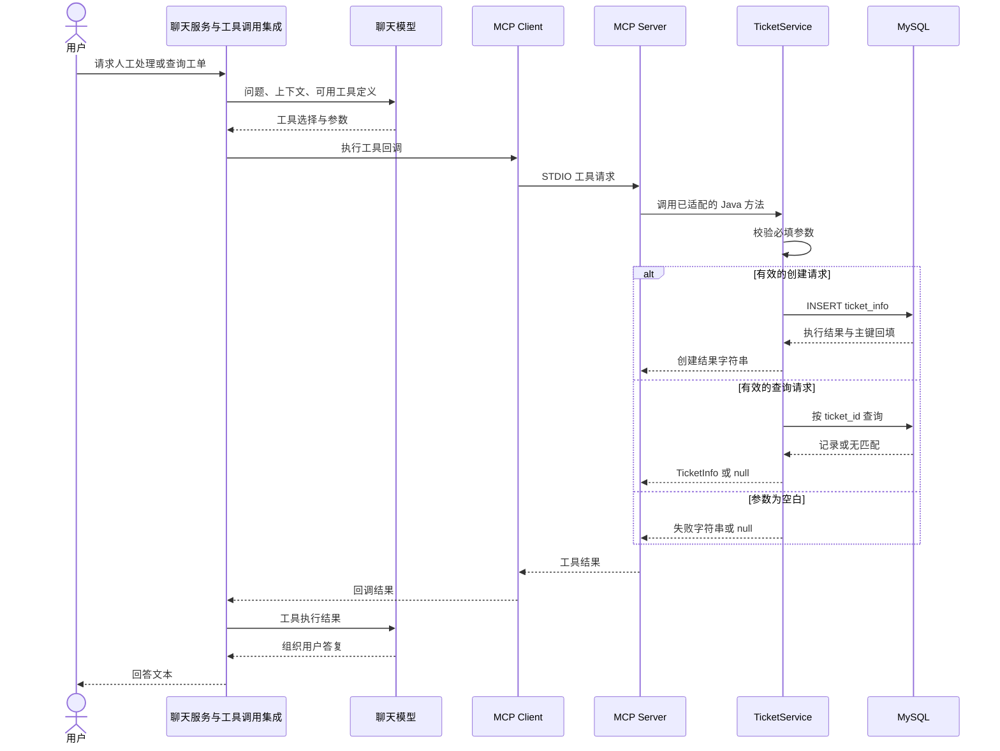

# 图灵教育智能客服项目技术文档

本文介绍项目实际采用的架构、技术栈、解决的问题和功能实现，重点分析 **RAG 知识库构建与检索、MCP 工具定义与调用、会话与工单持久化**。

## 1. 项目定位与解决的问题

### 1.1 项目定位

图灵教育智能客服是一个面向课程咨询的 Java 大模型应用。用户在网页中提问，系统通过课程知识检索和模型生成回答，并利用会话记忆支持连续咨询；需要工单处理时，模型可以调用独立工单服务提供的创建、查询工具。

知识资料使用“图灵算法教育”和“图灵算法课”作为品牌与课程名称，面向本科生、研究生，涵盖 Java 开发、C++ 开发和测试开发三个方向。

### 1.2 解决的问题与对应实现

| 问题 | 项目采用的方式 | 实际产出与代码位置 |
| --- | --- | --- |
| 课程信息分散，直接问通用模型缺少项目资料依据 | 把 Markdown 课程资料转换为可检索文档，接入 RAG | `DocumentLoader`、`DataInit`、`AdvisorFactory` 组成知识准备与问答链路 |
| 长文档难以作为精细的检索单元 | 按 token 长度分块，结合中英文标点调整边界 | `CustomTokenTextSplitter` 输出较小的知识片段 |
| 分块后需要补充主题描述，增强与入库任务可以并行 | 提取关键词 metadata，按批次交给固定线程池处理 | `KeywordEnricher` 与 `DataInit.processDocument` |
| 用户需要连续追问，并在刷新后找到已有会话 | ChatMemory 接入请求上下文，MySQL 保存会话列表 | `MessageChatMemoryAdvisor`、`JdbcChatHistoryRepository` |
| 对话除了生成文字，还需要执行具体业务操作 | 将工单创建、查询定义为 MCP 工具 | `TicketService`、`TicketTool` 与聊天侧工具回调接入 |
| 同一会话多次提问不应产生重复列表记录 | 数据库唯一键配合 upsert | `chat_sessions.chat_id` 唯一键与 `ChatSessionMapper.save` |
| 等待完整回答影响交互感受 | 服务端输出文本流，前端增量读取 | `Flux<String>` 与浏览器 Fetch 流式读取 |
| 部分输入需要按业务规则直接拒绝 | 自定义 Advisor 做敏感词子串匹配并短路 | `CustomSafeGuardAdvisor` 返回固定答复 |

这些设计说明项目实现了怎样的处理机制。知识检索质量、性能提升和实际业务效果需要结合运行数据评估，本文不提供未经测量的指标。

## 2. 技术栈与系统架构

### 2.1 技术栈

版本以 [聚合 POM](../smart-chat-assistant-bot/pom.xml)、[聊天服务 POM](../smart-chat-assistant-bot/chat-bot-service/pom.xml) 和 [工单服务 POM](../smart-chat-assistant-bot/ticket-service/pom.xml) 为准。

| 技术 | 仓库声明 | 在项目中的职责 |
| --- | --- | --- |
| Java / Maven | Java 17；Maven 聚合项目 | 构建聊天、工单两个子模块 |
| Spring Boot | 3.5.3 | 应用启动、自动配置、组件装配与 Web 服务 |
| Spring AI | BOM 1.0.1 | ChatClient、Advisor、ChatMemory、文档处理、VectorStore、工具与 MCP 集成 |
| Spring AI Alibaba | 聊天模块 BOM 1.0.0.2 | DashScope 模型接入、关键词增强所用聊天模型、重排 Advisor |
| Spring Web / WebFlux | 聊天模块同时引入 | Controller 请求入口与 Reactor 流式响应 |
| DashScopeChatModel | API Key 来自 `DASHSCOPE_API_KEY` | 回答生成与知识片段的关键词提取；聊天模型名称由有效配置决定 |
| Embedding | `text-embedding-v3` | 文档与查询文本的向量表示 |
| Rerank | `gte-rerank-v2` | 对候选知识片段进行相关性重排 |
| Redis VectorStore | Spring AI Redis starter | 课程知识向量存储与相似度检索 |
| MySQL / MyBatis | MyBatis starter 3.0.3 | 会话列表、工单的结构化存储 |
| JDBC ChatMemory Repository | Spring AI JDBC memory starter | 消息记忆仓储集成；具体运行绑定见第 6 节 |
| MCP Client / Server | Spring AI MCP starters | 聊天进程与工单工具进程之间的 STDIO 通信 |
| MarkdownDocumentReader / jtokkit | Markdown Reader 与 CL100K_BASE 编码器 | 文档解析和 token 分块 |
| HTML / CSS / JavaScript / jQuery | jQuery 3.6.0 | 聊天入口、会话列表与回答展示 |
| Lombok / SLF4J | 项目实体及日志使用 | 实体访问器与日志记录 |
| JUnit / AssertJ / H2 | Spring Boot test 与聊天模块 H2 测试依赖 | 会话仓储组件测试及工单 Service 测试 |

### 2.2 总体架构

系统由一个面向浏览器的聊天服务和一个提供 MCP 工具的工单服务组成。聊天服务组织模型、记忆、知识和工具；工单服务执行工单数据库操作。Redis 保存知识向量，MySQL 保存会话列表和工单等结构化数据。



Advisor 节点表示已注册的能力集合，图中的连接不代表各 Advisor 的实际执行顺序。两个服务各自配置数据库连接；图中以一个 MySQL 节点表示它们的存储职责。

### 2.3 模块职责

| 模块或组件 | 主要职责 | 核心实现 |
| --- | --- | --- |
| 聊天服务 | 提供 HTTP、页面、问答编排和会话管理 | `ChatController`、`CommonConfiguration` |
| RAG 组件 | 把资料转换为向量知识，并为在线回答提供检索上下文 | `rag` 包、Redis VectorStore |
| 工单服务 | 将创建、查询方法暴露为工具并执行 SQL | `TicketTool`、`TicketService`、`TicketMapper` |
| Redis | 保存知识向量与文档信息，参与相似度检索 | 索引 `chat-bot`，键前缀 `rag:` |
| MySQL | 保存会话列表、工单，以及配置接入的消息仓储数据 | `chat_sessions`、`ticket_info`、`SPRING_AI_CHAT_MEMORY` |
| 模型服务 | 生成回答、提取关键词、计算向量与重排 | DashScope 聊天、Embedding、Rerank 模型 |

两个业务模块通过 MCP 协作，聊天 Controller 不直接注入 `TicketService`。工单服务配置 `web-application-type: none`，由聊天侧按 STDIO 配置启动为子进程。

### 2.4 核心目录

```text
Smart-Chat-Assistant/
├── docs/
│   ├── 图灵教育智能客服项目技术文档.md
│   └── 图灵教育智能客服项目待完善与面试参考.md
└── smart-chat-assistant-bot/
    ├── pom.xml
    ├── chat-bot-service/
    │   ├── src/main/java/com/ai/chat/bot/
    │   │   ├── controller/ChatController.java
    │   │   ├── config/CommonConfiguration.java
    │   │   ├── advisor/CustomSafeGuardAdvisor.java
    │   │   ├── rag/                  # 导入、分块、增强、检索配置
    │   │   ├── repository/           # 会话列表仓储
    │   │   ├── mapper/ChatSessionMapper.java
    │   │   └── entity/               # 会话与消息展示对象
    │   ├── src/main/resources/
    │   │   ├── application.yml
    │   │   ├── file/                 # 四份 Markdown 知识资料
    │   │   ├── mcp/mcp-servers-config.json
    │   │   ├── sql/                  # 会话/消息建表与唯一键迁移
    │   │   └── static/               # 页面、脚本、样式与图片
    │   └── src/test/java/            # 会话列表持久化测试
    └── ticket-service/
        ├── src/main/java/com/ticket/demo/
        │   ├── TicketMcpApplication.java
        │   ├── config/TicketTool.java
        │   ├── service/TicketService.java
        │   ├── mapper/TicketMapper.java
        │   └── entity/TicketInfo.java
        ├── src/main/resources/application.yml
        └── src/test/java/            # 工单 Service 测试
```

## 3. 已实现功能与请求处理

### 3.1 功能清单

| 功能 | 触发方式 | 实现与结果 |
| --- | --- | --- |
| 课程咨询 | 用户提交课程相关问题 | ChatClient 通过已接入的检索、重排能力获取上下文并生成回答；使用前需完成知识入库 |
| 流式回答 | 页面调用 `/chat/stream` | 服务端返回 `Flux<String>`，页面累积读取并展示 |
| 连续对话 | 同一 chatId 下继续提问 | 通过 `ChatMemory.CONVERSATION_ID` 将记忆关联到当前会话 |
| 会话列表 | 首次提问、后续提问与刷新列表 | MySQL 新增或更新会话标题，按创建顺序返回列表 |
| 消息回看 | 切换已有会话 | 读取 ChatMemory 当前保留的消息，返回 role/content |
| 会话删除 | 用户删除会话 | 依次删除列表记录、清理消息记忆，返回 Boolean |
| 工单创建 | 模型选择创建工具 | 校验标题、描述、关联会话 ID，生成工单编号并入库 |
| 工单查询 | 模型选择查询工具 | 按工单编号查询，返回 TicketInfo 或 null |
| 敏感词拦截 | 输入包含配置词语 | 返回固定文本，停止该 Advisor 后续链路 |

### 3.2 一次咨询的处理过程

入口为 [ChatController.stream](../smart-chat-assistant-bot/chat-bot-service/src/main/java/com/ai/chat/bot/controller/ChatController.java)。页面生成或复用 chatId，使用 Fetch 提交问题并读取响应流。

1. Controller 调用 `chatHistoryRepository.save(chatId, prompt)`，保存或更新会话标题。
2. `ChatClient.prompt().user(prompt)` 设置本轮用户消息。
3. 请求级 system 文本传入当前会话 ID，Advisor 参数传入 `ChatMemory.CONVERSATION_ID`。
4. ChatClient 执行已经装配的 Advisor，接入记忆、知识增强、日志和敏感词处理。
5. 模型根据上下文生成答案；需要工单操作时，通过已注册工具回调进入 MCP 工单服务。
6. `.stream().content()` 输出回答文本，由页面增量显示。

```java
// ChatController 中的主要请求装配代码
chatHistoryRepository.save(chatId, prompt);
return this.chatClient.prompt()
        .user(prompt)
        .system(build -> build.text("当前会话id: %s".formatted(chatId)))
        .advisors(spec -> spec.param(ChatMemory.CONVERSATION_ID, chatId))
        .stream()
        .content();
```

接口媒体类型为 `text/html;charset=utf-8`，内容是回答文本流。会话列表保存发生在模型调用之前。

### 3.3 ChatClient、Advisor 与 Prompt 的分工

[CommonConfiguration](../smart-chat-assistant-bot/chat-bot-service/src/main/java/com/ai/chat/bot/config/CommonConfiguration.java) 是模型能力的集中装配点。

| 组件 | 作用 | 项目传入的配置 |
| --- | --- | --- |
| `SimpleLoggerAdvisor` | 记录模型交互相关信息 | Advisor 日志级别配置为 debug |
| `MessageChatMemoryAdvisor` | 将会话记忆接入对话 | 注入 ChatMemory；请求传 conversation ID |
| `QuestionAnswerAdvisor` | 用检索上下文增强用户问题 | 自定义 PromptTemplate |
| `RetrievalRerankAdvisor` | 接入候选检索与重排 | VectorStore、RerankModel、`topK(100)` |
| `CustomSafeGuardAdvisor` | 对命中的输入直接返回固定答复 | 敏感词“公务员”“政府”；默认 order 为 0 |

上表按代码声明顺序列出，执行顺序由框架排序机制决定。

Prompt 分布在三个位置：默认 system 定义课程咨询助手身份；Controller 设置当前会话 ID；`AdvisorFactory` 的问答模板使用 `{query}` 和 `{question_answer_context}` 组织问题与知识上下文。模板要求语义匹配、直接回答，并在课程资料不足或用户要求人工时引导模型创建工单。转工单属于 Prompt 引导，实际调用由模型选择和工具框架执行。

敏感词 Advisor 同时实现 `CallAdvisor`、`StreamAdvisor`，使用 `contains` 匹配。流式命中时返回 `Flux.just(...)`，不再调用 `nextStream`。

### 3.4 HTTP 接口

Controller 使用 `@RequestMapping`，没有通过注解限定 HTTP 方法；现有页面均以 GET 访问。

| 路径 | 参数 | 返回内容 | 主要用途 |
| --- | --- | --- | --- |
| `/chat/stream` | `prompt`、`chatId` | `Flux<String>` 文本流 | 提问、更新会话列表并获取回答 |
| `/chat/getChatIds` | 无 | `List<ChatInfo>` | 查询会话列表，字段为 chatId/title |
| `/chat/getChatHistory` | `chatId` | `List<MessageVO>` | 回看记忆中保留的消息，字段为 role/content |
| `/chat/deleteChat` | `chatId` | Boolean | 删除会话列表和对应消息记忆 |

## 4. RAG 知识库分析

### 4.1 知识内容与问题覆盖

知识源位于聊天服务的 `src/main/resources/file/`，包括四份 Markdown：

| 知识文件 | 主要内容 | 可提供依据的问题类型 |
| --- | --- | --- |
| [企业介绍.md](../smart-chat-assistant-bot/chat-bot-service/src/main/resources/file/企业介绍.md) | 品牌、课程定位、服务人群、三个课程方向、课程结构 | 面向哪些学生、有哪些方向、课程如何组织 |
| [Java 开发方向.md](<../smart-chat-assistant-bot/chat-bot-service/src/main/resources/file/Java 开发方向.md>) | Java 基础、算法、数据库、JavaEE、微服务、项目与精品课 | Java 方向学什么、课程阶段、项目训练内容 |
| [C++方向.md](../smart-chat-assistant-bot/chat-bot-service/src/main/resources/file/C++方向.md) | C/C++、算法、Linux、数据库及项目方案 | C++ 学习路径、系统与网络编程、项目实践 |
| [测试开发方向.md](../smart-chat-assistant-bot/chat-bot-service/src/main/resources/file/测试开发方向.md) | Java 基础、测试理论、接口/GUI 自动化与项目训练 | 测试开发所需基础、课程内容与训练方向 |

企业介绍提供全局背景，三个方向文件提供具体课程细节。课程资料同时包含标题、段落、表格和引用块，因此知识处理既涉及文本长度，也涉及结构保留。

四份文件均标明为改编稿，正式咨询前需要业务审核。知识中的技术名词属于被咨询的课程内容，项目本身的依赖以第 2 节为准。

### 4.2 知识准备与在线问答两个阶段

**知识准备阶段**把资料转为可检索记录，入口是 `DataInit.initData()`；**在线问答阶段**围绕本次用户问题检索和生成，入口是 `ChatController.stream()`。提问时不重新执行项目的启动导入逻辑。



当前 `data.is-load: false`，只表示启动时跳过导入。在线检索仍由 Advisor 接入，实际可用知识取决于 Redis 已保存的内容。

### 4.3 文档读取：Markdown 到 Document

[DocumentLoader](../smart-chat-assistant-bot/chat-bot-service/src/main/java/com/ai/chat/bot/rag/DocumentLoader.java) 使用 `PathMatchingResourcePatternResolver` 查找 `classpath:/file/*.md`，为每个资源创建 `MarkdownDocumentReader`，汇总 `reader.get()` 返回的 Document。

| Reader 配置 | 值 | 对解析的影响 |
| --- | --- | --- |
| `withHorizontalRuleCreateDocument` | true | 使用水平分隔线建立文档边界 |
| `withIncludeBlockquote` | false | 排除 Markdown 引用块 |

这里的 Document 是后续处理单元，文件数不等于 Document 数，Document 数也不等于最终向量数。当前引用块过滤会影响资料中采用 `>` 编写的声明与课程明细，保真处理事项集中在补充文档。

### 4.4 自定义分块：控制长度并照顾中文句界

[CustomTokenTextSplitter](../smart-chat-assistant-bot/chat-bot-service/src/main/java/com/ai/chat/bot/rag/CustomTokenTextSplitter.java) 继承 `TextSplitter`，使用 jtokkit 的 `CL100K_BASE` 进行 token 编码与解码。

| 参数 | 默认值 | 实际含义 |
| --- | --- | --- |
| `chunkSize` | 800 | 每轮最多取 800 个 token 作为候选片段 |
| `minChunkSizeChars` | 350 | 最后一个句末标点/换行的字符位置大于 350 时，截断到该位置 |
| `minChunkLengthToEmbed` | 5 | 处理后字符长度严格大于 5 才保留 |
| `maxNumChunks` | 10000 | 主循环次数上限，剩余文本在循环后追加 |
| `keepSeparator` | true | 默认保留片段内部换行等分隔内容，并 trim 首尾空白 |

处理顺序为：将文本编码为 token → 取候选片段 → 解码为文本 → 寻找 `. ? ! 。 ？ ！` 和换行中的最后位置 → 满足字符位置条件时截断 → 过滤过短片段 → 按实际消费的 token 数继续处理。

800 控制候选 token 数，350 用于判断是否在句界截断，5 用于过滤短片段，三者含义和单位不同。该策略使课程长文档能够按较细粒度参与检索，同时照顾中文标点附近的内容完整性。

### 4.5 关键词元信息增强

[KeywordEnricher](../smart-chat-assistant-bot/chat-bot-service/src/main/java/com/ai/chat/bot/rag/KeywordEnricher.java) 在分块后、向量入库前处理每一批 Document：

```java
KeywordMetadataEnricher enricher = KeywordMetadataEnricher
        .builder(chatModel)
        .keywordCount(5)
        .build();
return enricher.apply(documents);
```

`chatModel` 是注入的 `DashScopeChatModel`。增强器围绕片段内容提取关键词，目标数量设为 5，并将增强后的文档交给下一步存储。

| 数据或处理 | 职责 |
| --- | --- |
| 文档正文 | 承载可供检索和回答使用的课程知识 |
| 关键词 metadata | 补充当前知识片段的主题描述 |
| Embedding | 把文本转换为用于相似度检索的向量表示 |
| Rerank | 进一步比较候选知识与当前问题的相关性 |

关键词生成直接调用聊天模型，不经过客服 ChatClient 的记忆、RAG 和工单工具链。代码把提取行为委托给增强组件；metadata 的实际字段形式及其对检索的影响，需要结合组件输出和向量记录确认。

### 4.6 线程池与批次入库

[DataInit](../smart-chat-assistant-bot/chat-bot-service/src/main/java/com/ai/chat/bot/rag/DataInit.java) 先在初始化线程完成读取和分块，再执行 `processDocument(splitterDocuments, 10)`。

| 项目 | 实现 |
| --- | --- |
| 线程池 | 一个 `Executors.newFixedThreadPool(8)` |
| 批次大小 | 每批最多 10 个 Document |
| 任务数 | `ceil(分块文档数 / 10)` |
| 批次容器 | `new ArrayList<>(documents.subList(...))` |
| 每个任务 | 先 `enricher.enrich(part)`，再 `vectorStore.add(enrichDocuments)` |
| 完成协调 | `CountDownLatch` 初始计数等于批次数，每个任务在 finally 中减一 |
| 等待 | 初始化线程最多等待 10 分钟 |

```text
初始化线程：读取 → 分块 → 划分批次 → 提交任务 → 等待
工作线程 1：批次 1 关键词增强 → 向量入库 → countDown
工作线程 2：批次 2 关键词增强 → 向量入库 → countDown
……最多 8 个工作线程并行处理批次……
```

例如分块后有 95 个 Document，就会提交 10 个任务，末批为 5 个文档。这个例子只解释批次数量，不能据此推导模型请求并发数或实测吞吐。

这种组织方式允许不同批次并行执行模型增强和向量写入。Latch 用于等待任务结束；失败任务同样会减一，因此任务结束与全部入库成功需要区分。失败统计、超时和线程生命周期的完善事项见补充文档。

### 4.7 向量化与 Redis 存储

增强后的文档通过 `VectorStore.add(...)` 进入向量存储集成，由框架完成 Embedding 调用与 Redis 写入。

| 配置 | 当前值 | 作用 |
| --- | --- | --- |
| Embedding 模型 | `text-embedding-v3` | 为文本提供向量表示 |
| `initialize-schema` | true | 允许向量存储组件初始化索引结构 |
| `index-name` | `chat-bot` | 知识检索使用的 Redis 索引 |
| `prefix` | `rag:` | 知识记录的键前缀 |

数据形态依次为：资源文件 → Document → 分块 Document → 带关键词 metadata 的 Document → 向量存储记录。Redis 在本项目中承担知识检索存储职责，会话列表由 MySQL 保存。

### 4.8 在线检索与重排

[AdvisorFactory](../smart-chat-assistant-bot/chat-bot-service/src/main/java/com/ai/chat/bot/rag/AdvisorFactory.java) 配置了两类知识增强组件：

| 组件 | 项目装配方式 | 作用 |
| --- | --- | --- |
| `QuestionAnswerAdvisor` | 传入 VectorStore 与自定义 PromptTemplate | 为用户问题补充检索上下文，并应用客服问答规则 |
| `RetrievalRerankAdvisor` | 传入 VectorStore、RerankModel、`SearchRequest.builder().topK(100).build()` | 接入候选检索与重排 |

`topK(100)` 是重排 Advisor 的候选检索参数，不能理解为回答一定使用 100 个片段。问答 Advisor 的候选数量没有在业务代码中显式指定。

两个 Advisor 都持有 VectorStore，源码没有显式把一个的结果交给另一个。因此这里描述的是已接入的检索和重排能力；实际检索次数、执行顺序和最终上下文，应通过运行链路确认。

以“Java 方向会学哪些数据库内容”为例，预期流程是围绕问题检索相关课程片段，将候选知识用于问答增强，再由模型形成回答。这是对链路用途的说明，不是一次真实查询记录。RAG 提供资料依据，MCP 则在需要时执行工单操作，两者共同接入同一个 ChatClient。

## 5. MCP 工具定义与调用

### 5.1 工具服务的职责

项目使用 MCP 将工单操作接入客服对话：模型依据工具描述选择操作并生成参数，聊天侧工具回调通过 STDIO 调用工单进程，`TicketService` 执行方法并通过 MyBatis 访问 MySQL。

这里的 Tool Calling 负责把模型的选择与可执行操作连接起来，MCP 负责聊天进程和工具进程之间的接入与通信。SQL 由工单服务执行。

### 5.2 工具清单

工具声明位于 [TicketService](../smart-chat-assistant-bot/ticket-service/src/main/java/com/ticket/demo/service/TicketService.java)。下表用 Java 方法名标识工具；代码未自定义工具别名，具体对外名称与 JSON Schema 由框架生成并可在运行工具清单中核对。

| 方法 | `@Tool` 描述 | 参数 | Java 返回类型 |
| --- | --- | --- | --- |
| `createTicket` | 根据工单标题, 描述和关联会话ID, 创建工单 | title、description、relatedChatId | String |
| `queryTicketInfo` | 根据工单ID查询工单信息 | ticketId | TicketInfo；无结果时可为 null |

#### 创建工单：createTicket

源码通过注解描述操作与参数，以下展示方法签名，省略实现体：

```java
@Tool(description = "根据工单标题, 描述和关联会话ID, 创建工单")
public String createTicket(
        @ToolParam(description = "工单标题, 不能为空") String title,
        @ToolParam(description = "工单描述, 不能为空") String description,
        @ToolParam(description = "关联的会话ID, 不能为空") String relatedChatId) {
    // 实现见 TicketService.java
}
```

| 参数 | 类型 | 含义 | 服务端校验 |
| --- | --- | --- | --- |
| `title` | String | 工单标题 | `StringUtils.hasText(title)` |
| `description` | String | 需要后续处理的问题描述 | `StringUtils.hasText(description)` |
| `relatedChatId` | String | 关联当前咨询的会话 ID | `StringUtils.hasText(relatedChatId)` |

参数示意如下，仅用于解释契约：

```json
{
  "title": "咨询课程安排",
  "description": "用户希望由人工顾问确认具体排课安排",
  "relatedChatId": "11111111-1111-4111-8111-111111111111"
}
```

创建逻辑为：依次校验三个参数 → 生成工单编号 → 构建 TicketInfo → 插入数据库 → 返回文本结果。

工单编号格式为 `TL-SF-<毫秒时间戳>-<四位随机数>`。Mapper 实际写入 `ticket_id`、`title`、`description`、`related_chat_id` 四个业务字段，并配置数据库主键 `id` 回填。

| 场景 | 当前返回行为 |
| --- | --- |
| title、description 或 relatedChatId 为空白 | 返回“创建工单失败, 缺少必填参数'参数名'” |
| INSERT 调用正常返回 | 返回“工单创建成功, 工单ID:工单编号” |
| INSERT 抛出异常 | 返回“工单创建失败, e:”加异常消息 |

#### 查询工单：queryTicketInfo

```java
@Tool(description = "根据工单ID查询工单信息")
public TicketInfo queryTicketInfo(
        @ToolParam(description = "工单ID, 不能为空") String ticketId) {
    // 实现见 TicketService.java
}
```

| 参数或结果 | 含义 |
| --- | --- |
| `ticketId` | 工单业务编号，与数据库自增 id 区分 |
| 输入为空白 | 直接返回 null |
| 输入有文本 | 执行 `select * from ticket_info where ticket_id = #{ticketId}` |
| 查询到记录 | 返回 TicketInfo |
| 无匹配记录 | 返回 null |

TicketInfo 包含 `id`、`ticketId`、`title`、`description`、`relatedChatId`、`status`、`creator`、`assignee`、`createdTime`、`updatedTime`、`closedTime`。查询工具读取数据库已有记录，这些字段的业务含义与写入范围见第 6 节。

### 5.3 从注解到可调用工具

[TicketTool](../smart-chat-assistant-bot/ticket-service/src/main/java/com/ticket/demo/config/TicketTool.java) 将业务 Service 适配为工具提供者：

```java
@Bean
public ToolCallbackProvider toolCallbackProvider(TicketService ticketService) {
    return MethodToolCallbackProvider.builder()
            .toolObjects(ticketService)
            .build();
}
```

工单模块的 MCP Server starter 接入工具集合。聊天侧由 `CommonConfiguration` 注入自身的 `ToolCallbackProvider`，再通过下列配置交给 ChatClient：

```java
// ChatClient 构建过程中的工具接入配置
.defaultToolCallbacks(toolCallbackProvider)
```

| 环节 | 项目使用的机制 | 作用 |
| --- | --- | --- |
| 操作定义 | `@Tool(description = ...)` | 向模型描述工具能做什么 |
| 参数定义 | `@ToolParam(description = ...)` | 描述每个参数的业务含义 |
| 方法适配 | `MethodToolCallbackProvider` | 将带注解的 Service 方法提供为工具回调 |
| 服务端暴露 | MCP Server starter | 将工单工具接入 MCP 服务 |
| 客户端连接 | MCP Client starter 与 STDIO JSON | 启动并连接工具子进程 |
| 模型接入 | `ChatClient.defaultToolCallbacks` | 将聊天侧可用工具纳入模型调用 |
| 业务执行 | `TicketService` → `TicketMapper` | 校验参数、执行数据库操作并产生结果 |

两个进程中的 Provider 职责不同：工单侧包装本进程业务方法，聊天侧将可调用的工具接入模型。工具发现、参数 schema、协议序列化与回调适配由框架集成承担，项目的自定义代码主要集中在业务方法和装配配置。

### 5.4 STDIO 进程配置

聊天侧通过 `spring.ai.mcp.client.stdio.servers-configuration` 读取 [mcp-servers-config.json](../smart-chat-assistant-bot/chat-bot-service/src/main/resources/mcp/mcp-servers-config.json)。配置结构如下，JAR 路径以占位符表示：

```json
{
  "mcpServers": {
    "ticket-service": {
      "command": "java",
      "args": [
        "-Dspring.ai.mcp.server.stdio=true",
        "-Dlogging.pattern.console=",
        "-Dfile.encoding=UTF-8",
        "-jar",
        "<工单服务可执行JAR的绝对路径>"
      ]
    }
  }
}
```

工单服务配置 `web-application-type: none` 和 `banner-mode: off`。STDIO 使用子进程的标准输入、标准输出通信，关闭控制台日志格式和启动 banner 的目的是减少非协议内容对输出通道的干扰。

### 5.5 一次工单调用的完整链路



该图描述已配置的正常调用关系。模型选择与调用循环由框架处理；项目在工单服务端实现参数校验和数据库操作，并将结果交回对话链路。

## 6. 数据持久化设计

### 6.1 四类数据的职责

| 数据 | 保存位置或访问方式 | 用途 |
| --- | --- | --- |
| 课程知识 | Redis VectorStore，索引 `chat-bot` | 为课程问题检索相关片段 |
| 会话列表 | MySQL `chat_sessions`，项目 MyBatis Mapper | 保存 chatId、标题与创建/更新时间，展示会话入口 |
| 对话消息 | 注入的 ChatMemory；配置了 JDBC 仓储及 `SPRING_AI_CHAT_MEMORY` 表 | 提供多轮上下文，并供历史接口读取当前保留的消息 |
| 工单记录 | MySQL `ticket_info`，TicketMapper | 保存问题描述与关联会话，供工具查询 |

消息层的具体窗口和存储后端以运行时 ChatMemory Bean 为准；JDBC 绑定验证事项见补充文档。会话列表存在与消息保留范围是两个独立问题。

### 6.2 会话列表：唯一键与 upsert

[JdbcChatHistoryRepository](../smart-chat-assistant-bot/chat-bot-service/src/main/java/com/ai/chat/bot/repository/JdbcChatHistoryRepository.java) 是当前注册的列表仓储实现，调用 [ChatSessionMapper](../smart-chat-assistant-bot/chat-bot-service/src/main/java/com/ai/chat/bot/mapper/ChatSessionMapper.java) 访问数据库。

| `chat_sessions` 字段 | 类型 | 作用 |
| --- | --- | --- |
| `id` | INT，自增主键 | 标识记录并用于创建顺序排序 |
| `chat_id` | VARCHAR(36)，唯一且非空 | 会话业务标识 |
| `title` | VARCHAR(127)，非空 | 列表展示标题 |
| `created_time` | DATETIME | 创建时间 |
| `updated_time` | DATETIME | 更新时间 |

保存使用以下 MyBatis 参数化 SQL：

```sql
INSERT INTO chat_sessions (chat_id, title)
VALUES (#{chatId}, #{title})
ON DUPLICATE KEY UPDATE title = #{title}, updated_time = CURRENT_TIMESTAMP
```

`chat_id` 唯一键决定同会话走新增还是更新分支。同一 chatId 多次保存只保留一条列表记录，标题更新后原行 id 保持不变。

标题由 `ChatInfo` 处理：null 转为“无标题”，长度达到 15 时取前 15 个 Java 字符单位。每次提问都会更新标题。后端按 `id ASC` 查询，前端反转展示，因此页面按创建顺序倒序排列。

### 6.3 消息记忆与历史读取

消息上下文通过 `MessageChatMemoryAdvisor` 与 ChatMemory 接入。Controller 在每次请求中设置会话参数；历史接口调用 `chatMemory.get(chatId)`，再转换为 `MessageVO`。

| MessageVO 字段 | 内容 |
| --- | --- |
| `role` | user、assistant、system 或 tool |
| `content` | 消息文本 |

[建表脚本](../smart-chat-assistant-bot/chat-bot-service/src/main/resources/sql/schema-mysql.sql) 中的 `SPRING_AI_CHAT_MEMORY` 包含 `conversation_id`、`content`、`type`、`timestamp`，并在会话 ID 和时间戳上建立联合索引。历史接口的读取范围取决于注入记忆组件当前保留的消息。

### 6.4 工单数据与会话关联

| TicketInfo 字段 | 职责 | 当前代码的使用方式 |
| --- | --- | --- |
| `id` | 数据库主键 | INSERT 时配置生成键回填 |
| `ticketId` | 对外工单编号 | Service 生成；查询工具按此查找 |
| `title`、`description` | 问题摘要与详情 | 创建工具参数，写入数据库 |
| `relatedChatId` | 关联咨询会话 | 创建工具参数，写入数据库 |
| `status`、`creator`、`assignee` | 状态及参与人信息 | 实体定义，查询已有记录时承载相应字段 |
| `createdTime`、`updatedTime`、`closedTime` | 生命周期时间信息 | 实体定义，查询已有记录时承载相应字段 |

项目提供的是工单 Mapper 和实体，表的实际默认值、约束与状态含义应以真实数据库结构为准。删除聊天的代码只处理会话列表和 ChatMemory，不调用工单删除方法，也不删除 Redis 知识。

## 7. 关键配置与本地运行入口

### 7.1 配置索引

配置文件为 [聊天服务 application.yml](../smart-chat-assistant-bot/chat-bot-service/src/main/resources/application.yml)、[工单服务 application.yml](../smart-chat-assistant-bot/ticket-service/src/main/resources/application.yml) 和 MCP JSON。以下只展示非敏感配置值。

| 配置 | 当前值或来源 | 作用 |
| --- | --- | --- |
| 聊天服务 `server.port` | 8081 | Web 服务端口 |
| `spring.ai.dashscope.api-key` | `${DASHSCOPE_API_KEY}` | 模型服务凭证 |
| `spring.ai.dashscope.embedding.options.model` | `text-embedding-v3` | Embedding 模型 |
| `spring.ai.dashscope.rerank.options.model` | `gte-rerank-v2` | 重排模型 |
| `data.is-load` | false | 是否在启动时执行知识导入 |
| `spring.ai.vectorstore.redis.index-name` | `chat-bot` | 向量索引名 |
| `spring.ai.vectorstore.redis.prefix` | `rag:` | 向量记录前缀 |
| `spring.ai.vectorstore.redis.initialize-schema` | true | 向量索引初始化开关 |
| `spring.ai.chat.memory.repository.jdbc.initialize-schema` | always | JDBC 消息仓储 schema 初始化配置 |
| `spring.ai.chat.memory.repository.jdbc.schema` | `classpath:/sql/schema-mysql.sql` | 会话与消息表 SQL |
| `spring.ai.mcp.client.stdio.servers-configuration` | `classpath:/mcp/mcp-servers-config.json` | 工具进程启动配置 |
| `spring.ai.mcp.client.request-timeout` | 60000 | MCP 客户端请求超时配置原值 |
| 工单 `spring.ai.mcp.server.name/version` | `ticket-service` / `0.0.1` | MCP 服务身份 |
| 工单 `spring.main.web-application-type` | none | 以非 Web 进程运行 |
| 工单 `mybatis.configuration.map-underscore-to-camel-case` | true | 数据库列名到 Java 字段映射 |

### 7.2 运行所需条件与顺序

准备 JDK 17、Maven、可用的 DashScope 服务、具有向量搜索能力的 Redis，以及 MySQL。数据库需具备会话表、消息表和实际工单表；已有会话表的唯一键迁移说明见 [chat-session-persistence.md](../smart-chat-assistant-bot/chat-bot-service/docs/chat-session-persistence.md)。

1. 配置模型凭证、两个模块的数据库连接及聊天模块的 Redis 连接。
2. 从仓库根目录构建工单可执行 JAR：

   ```powershell
   mvn -f .\smart-chat-assistant-bot\pom.xml -pl ticket-service -am package "-DskipTests"
   ```

3. 将 MCP JSON 中的路径配置为实际 `ticket-service-1.0-SNAPSHOT.jar` 路径。
4. 在 IDE 中启动 `com.ai.chat.bot.SpringChatBotApplication`；MCP 客户端按配置启动工单子进程。
5. 首次准备知识时，将 `data.is-load` 设为 true 执行导入，核对批次结果与 Redis 内容后恢复为 false。
6. 访问 [本地聊天页面](http://localhost:8081/)，验证课程问答、连续追问、会话回看、创建和查询工单。

以上为运行步骤，本次文档整理未启动服务或调用外部模型、Redis、数据库。导入会调用模型并写入 Redis；现有工单测试会直接调用写数据库的方法，因此构建示例跳过测试。

## 8. 核心代码与已有验证范围

### 8.1 核心代码索引

| 阅读目标 | 代码位置 |
| --- | --- |
| HTTP、会话参数与流式回答 | [ChatController](../smart-chat-assistant-bot/chat-bot-service/src/main/java/com/ai/chat/bot/controller/ChatController.java) |
| 模型、Advisor 与工具装配 | [CommonConfiguration](../smart-chat-assistant-bot/chat-bot-service/src/main/java/com/ai/chat/bot/config/CommonConfiguration.java) |
| RAG Prompt 与重排配置 | [AdvisorFactory](../smart-chat-assistant-bot/chat-bot-service/src/main/java/com/ai/chat/bot/rag/AdvisorFactory.java) |
| 文档读取 | [DocumentLoader](../smart-chat-assistant-bot/chat-bot-service/src/main/java/com/ai/chat/bot/rag/DocumentLoader.java) |
| token 与中文标点分块 | [CustomTokenTextSplitter](../smart-chat-assistant-bot/chat-bot-service/src/main/java/com/ai/chat/bot/rag/CustomTokenTextSplitter.java) |
| 关键词增强 | [KeywordEnricher](../smart-chat-assistant-bot/chat-bot-service/src/main/java/com/ai/chat/bot/rag/KeywordEnricher.java) |
| 批次、线程池与向量入库 | [DataInit](../smart-chat-assistant-bot/chat-bot-service/src/main/java/com/ai/chat/bot/rag/DataInit.java) |
| 敏感词短路处理 | [CustomSafeGuardAdvisor](../smart-chat-assistant-bot/chat-bot-service/src/main/java/com/ai/chat/bot/advisor/CustomSafeGuardAdvisor.java) |
| 会话列表持久化 | [JdbcChatHistoryRepository](../smart-chat-assistant-bot/chat-bot-service/src/main/java/com/ai/chat/bot/repository/JdbcChatHistoryRepository.java)、[ChatSessionMapper](../smart-chat-assistant-bot/chat-bot-service/src/main/java/com/ai/chat/bot/mapper/ChatSessionMapper.java) |
| 工具提供者 | [TicketTool](../smart-chat-assistant-bot/ticket-service/src/main/java/com/ticket/demo/config/TicketTool.java) |
| 工具定义与业务规则 | [TicketService](../smart-chat-assistant-bot/ticket-service/src/main/java/com/ticket/demo/service/TicketService.java) |
| 工单 SQL 与数据对象 | [TicketMapper](../smart-chat-assistant-bot/ticket-service/src/main/java/com/ticket/demo/mapper/TicketMapper.java)、[TicketInfo](../smart-chat-assistant-bot/ticket-service/src/main/java/com/ticket/demo/entity/TicketInfo.java) |

### 8.2 现有测试覆盖

| 测试文件 | 源码覆盖内容 |
| --- | --- |
| [JdbcChatHistoryRepositoryTest](../smart-chat-assistant-bot/chat-bot-service/src/test/java/com/ai/chat/bot/repository/JdbcChatHistoryRepositoryTest.java) | 5 个测试方法：唯一仓储 Bean、upsert 与顺序、标题处理、删除与上下文重建、并发去重、独立 JVM 持久化等场景 |
| [TicketServiceTest](../smart-chat-assistant-bot/ticket-service/src/test/java/com/ticket/demo/TicketServiceTest.java) | 2 个方法，直接调用工单创建和查询并打印结果 |


